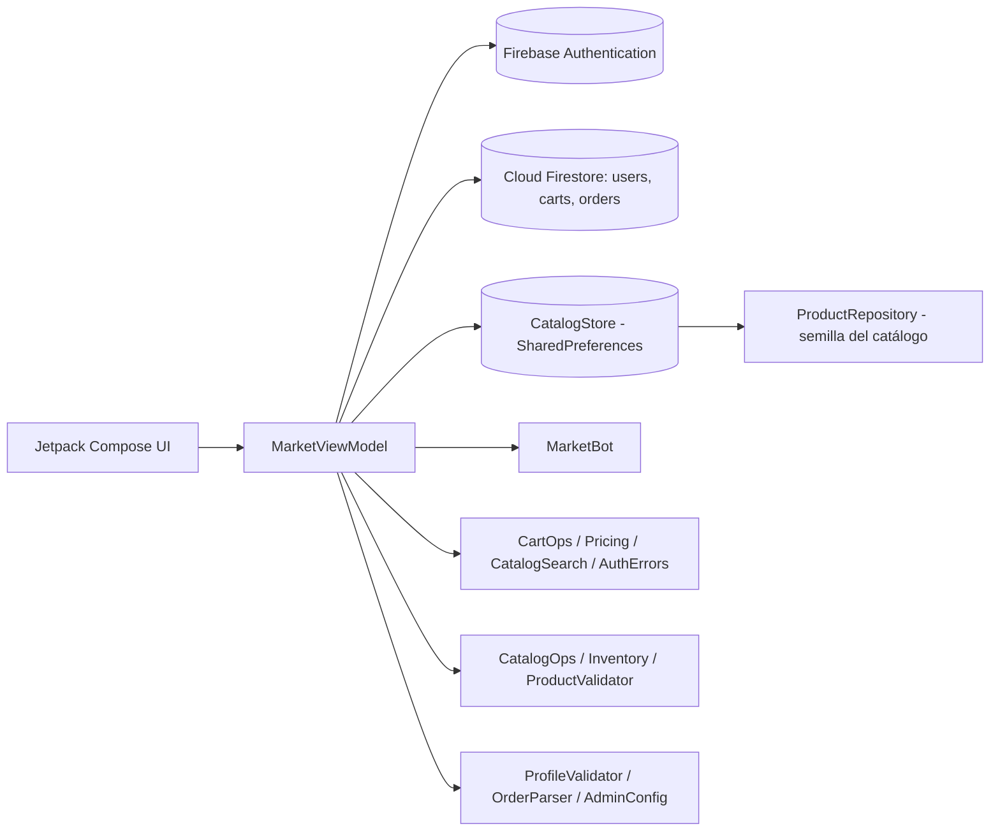

# Arquitectura — Marketplace

Patrón: UI declarativa (Jetpack Compose) + ViewModel + lógica pura en Kotlin (fácil de probar).
La navegación cambia según el **rol** del usuario (Comprador o Administrador).

Diagramas completos (arquitectura, navegación por rol, modelo de datos y clases) en `Documentacion/Modelos_Datos/`.
